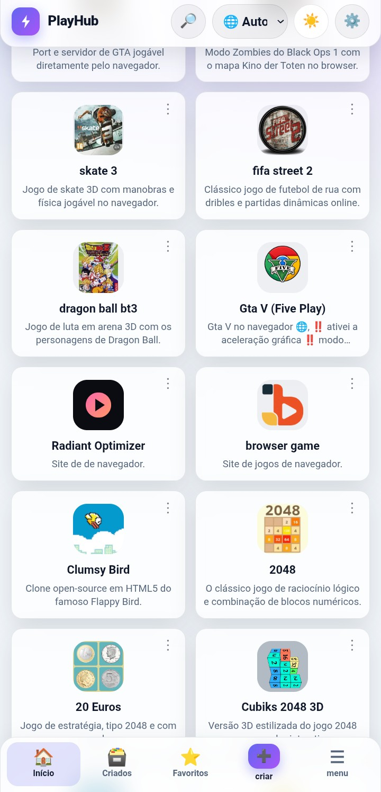
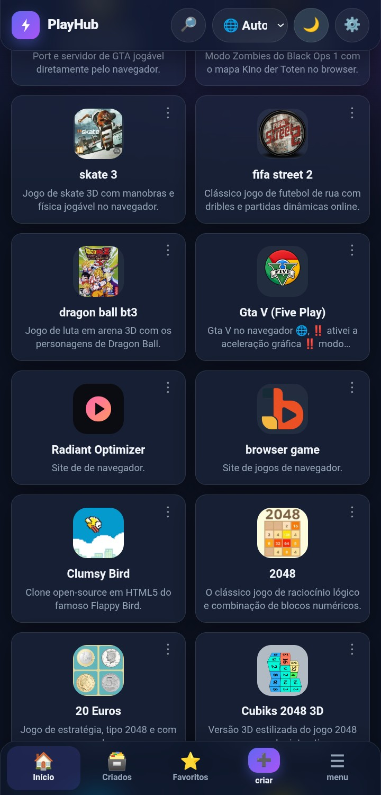
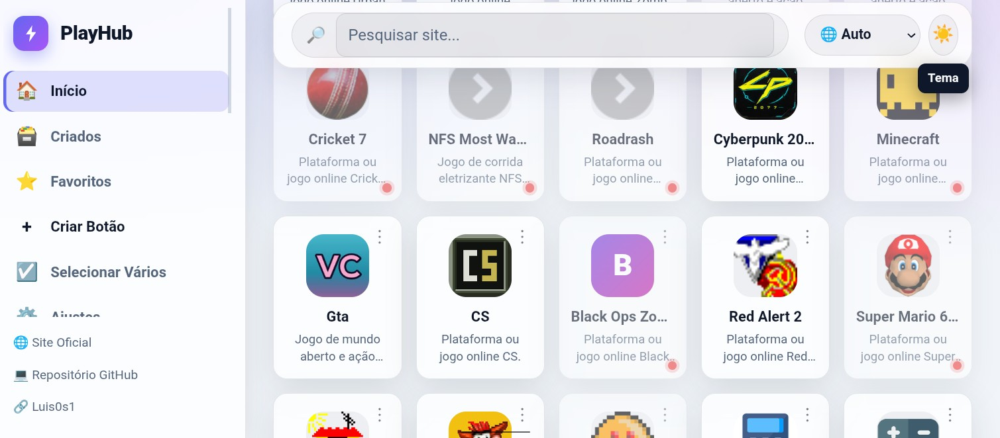
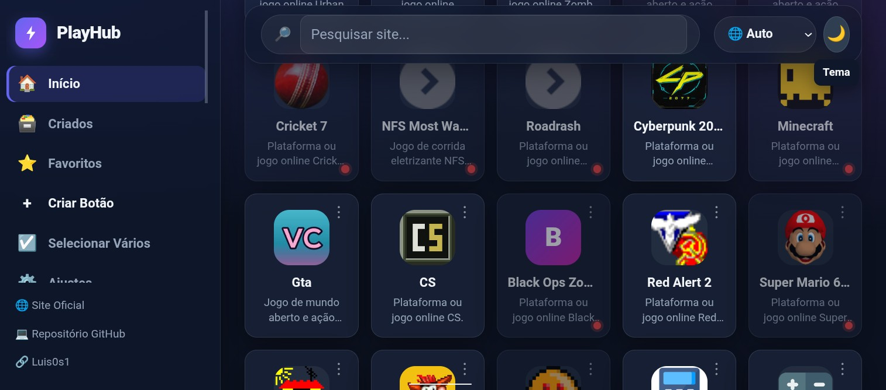

# ⚡ PlayHub - Apps & Games Center

[](https://luis0s1.github.io/playhub/)

**PlayHub** is a fast, modern, resilient, and feature-rich web portal built to provide instant access to browser games, AI platforms, streaming services, developer tools, graphic design applications, and productivity suites.

It functions seamlessly as a standalone web page, an installable Progressive Web App (PWA), or an unpacked web browser extension (Manifest V3).

---

## 🌟 Comprehensive Feature Overview

* 📱 **Multi-Platform Responsiveness**: Fully optimized for desktop monitors, tablets, mobile browsers, and installed PWA standalone windows.
* 🎨 **Advanced Icon Customization**: Switch on the fly between local images (`.webp`/`.png`), high-res SVG color icons, simple monochrome SVGs, or native emojis directly via the Settings panel.
* 🌙 **Dynamic Theme System**: Choose between Dark Mode, Light Mode, or automatic System Theme detection (`prefers-color-scheme`).
* 🌐 **Multi-Language Engine**: Built-in support for English and Portuguese with real-time browser language auto-detection.
* 🔍 **Real-Time Filtering & Category Navigation**: Filter your dashboard instant-by-name, description, or through dynamic category navigation chips.
* ⚡ **Quick Launcher**: Access an instant search overlay modal (`Space`/`Enter` shortcuts) to search and open any link without scrolling.
* ℹ️ **Interactive Site Details Panel**: View extended site metadata, tags, licensing info (Free, Freemium, Open Source), and online/offline status checks.
* ⌨️ **WASD & Keyboard Controls**: Full keyboard navigation support (Arrow keys, WASD, Space, Enter) for intuitive accessibility.
* 📋 **Multi-Select & Bulk Operations**: Select multiple site cards at once to favorite or hide them in bulk.
* 🗃️ **Custom Link Creator**: Add, edit, or remove your own custom web links with automatic site-name extraction and icon detection.
* 📦 **Data Backup & Restore**: Full JSON-based import and export capabilities for custom links, preferences, and favorites.
* 📡 **Offline Availability & Ping Checks**: Service Worker integration (`sw.js`) and background network ping checks ensure smooth offline usage and status reporting.

---

<p align="center">
  <a href="https://luis0s1.github.io/playhub/">
    
  </a>
  &nbsp;&nbsp;
  <a href="https://luis0s1.github.io/playhub/">
    
  </a>
</p>
<p align="center">
  <a href="https://luis0s1.github.io/playhub/">
    
  </a>
  &nbsp;&nbsp;
  <a href="https://luis0s1.github.io/playhub/">
    
  </a>
</p>
<p align="center">
  <sub>☀️ <b>Modo Claro</b> &nbsp;&nbsp;&nbsp;&nbsp;&nbsp;&nbsp;&nbsp;&nbsp;&nbsp;&nbsp;&nbsp;&nbsp;&nbsp;&nbsp;&nbsp;&nbsp;&nbsp;&nbsp;&nbsp;&nbsp;&nbsp;&nbsp;&nbsp;&nbsp;&nbsp;&nbsp;&nbsp;&nbsp; 🌙 <b>Modo Escuro</b></sub>
</p>


---

## 📂 Project Architecture

Copy the full file tree structure below:

```text
playhub/
├── index.html              # Main interface, resilience loader & site modal markup
├── script.js              # Core logic, state management & icon rendering engine
├── sites.js               # Primary dataset loader & category renderer
├── i18n.js                # Internationalization dictionary & language engine
├── style.css              # Glassmorphism design system & responsive layout
├── manifest.json           # Web App Manifest for PWA & Extension configuration
├── background.js          # Background service worker script for extension features
├── sw.js                  # PWA offline cache Service Worker
├── icons-site/            # Local high-resolution WebP and PNG icon assets
└── sites/                 # Modular dataset JS files by category:
    ├── ai.js              # Artificial Intelligence tools & chatbots
    ├── apps.js            # Web applications & utility tools
    ├── audio.js           # Music production & streaming platforms
    ├── design.js          # Vector, UI & graphic editing suites
    ├── dev.js             # Developer resources, APIs & repositories
    ├── games.js            # Browser & retro emulation games
    ├── movies-&-series.js # Movies, series & video streaming links
    ├── others.js           # Miscellaneous platforms & custom tools
    ├── productivity.js   # Project management & task trackers
    └── video.js           # Video editors & media platforms
